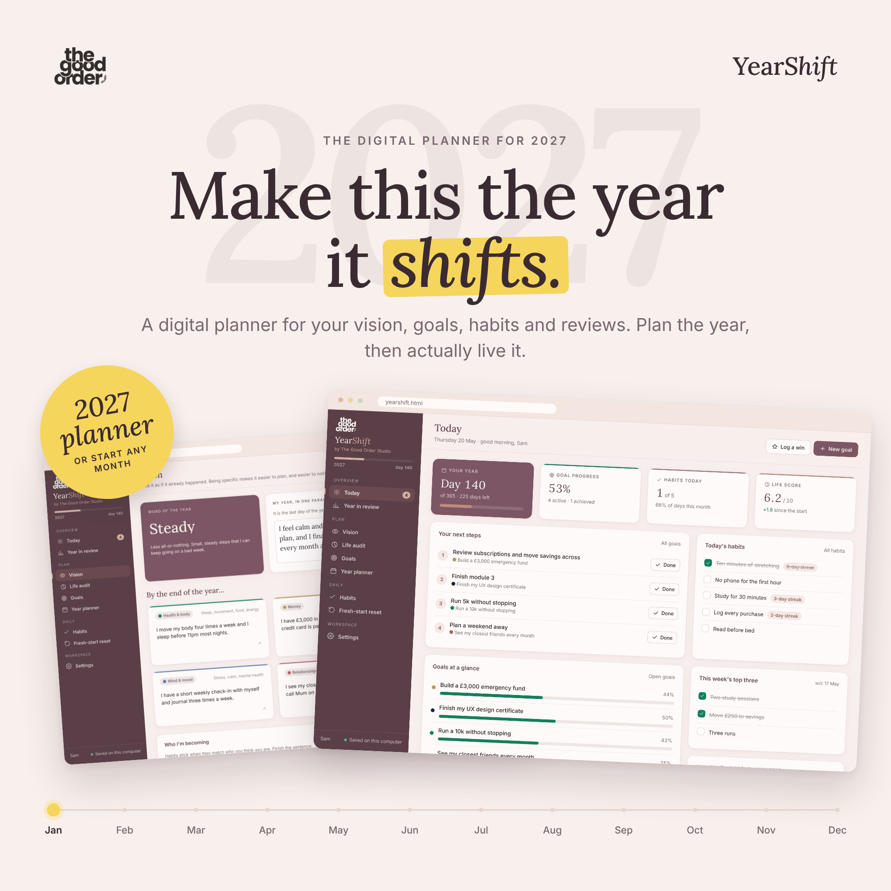
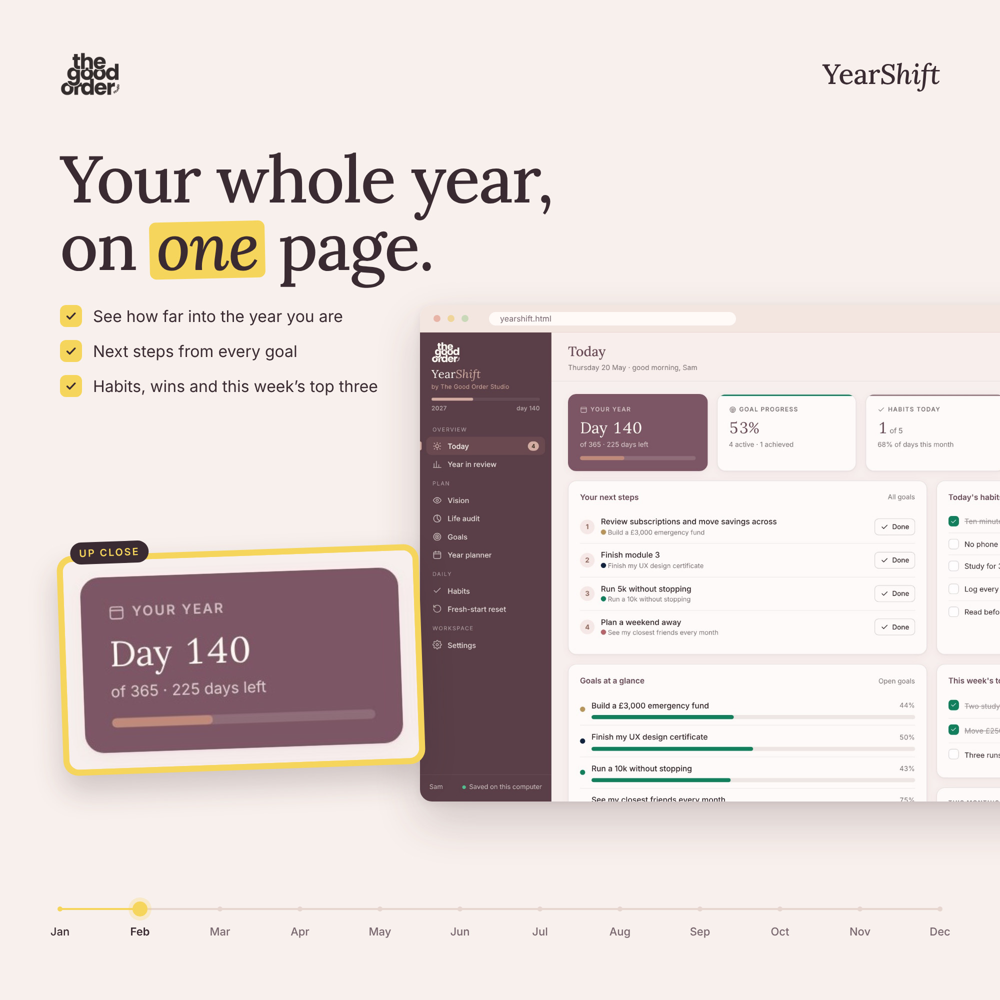
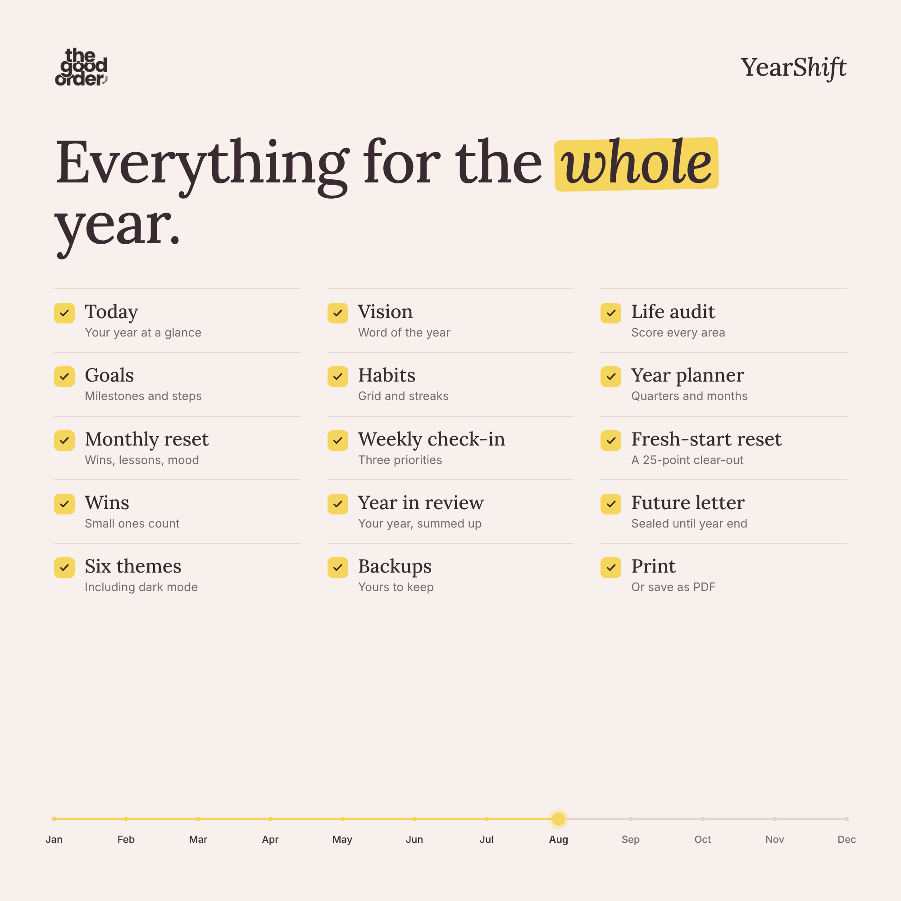

# YearShift — free demo

your year, in good order.

This is the free demo of YearShift by The Good Order Studio, a 2027 transformation planner for your vision, goals, habits, monthly resets and year-end review, all in one calm app.

▶ Try it: https://thegoodorderstudio.github.io/yearshift-demo/

- Explore a fictional sample year, already filled in
- Try Today, your vision, the life audit, goals with milestones, the year planner, habits and the year in review
- Nothing to install, no account, and nothing is sent to a server
- Best on a computer, in Chrome, Edge, Firefox or Safari

The full version, with the step-by-step user guide, is available from The Good Order Studio.

---

© 2026 The Good Order Studio. All rights reserved.

YearShift is original, copyrighted work. This demo is for trying YearShift in your browser only. It is **not open source**: copying, modifying, reselling, rebranding, re-hosting or using it, its code or its images to make other products is not permitted. See [LICENSE](LICENSE).
